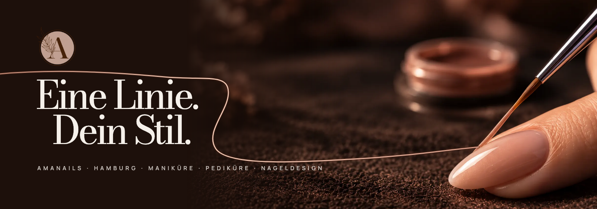
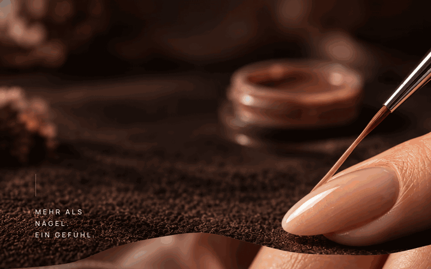
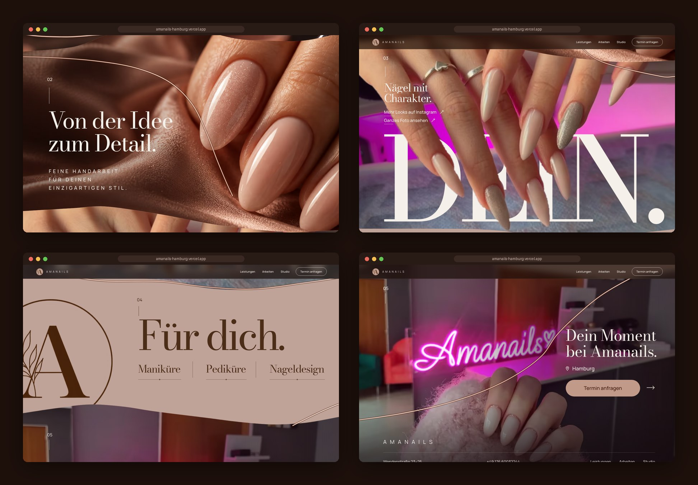
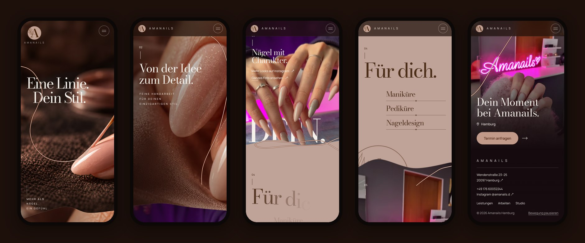
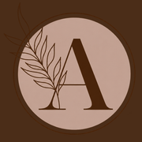

<div align="center">



<h3>A one-page website for a Hamburg nail studio, built around one rosé line that leaves the brush and runs through the whole page.</h3>

<p>
  <a href="https://amanails-hamburg.vercel.app"><strong>🌐 Live site</strong></a>
  &nbsp;·&nbsp;
  <a href="#hero-animation"><strong>🎬 How the hero works</strong></a>
  &nbsp;·&nbsp;
  <a href="#getting-started"><strong>🛠️ Run it locally</strong></a>
</p>

<p>
  <a href="https://amanails-hamburg.vercel.app"></a>
  
  
  
  
</p>

</div>

<br />

## 🚀 Overview

**Amanails** does manicure, pedicure and nail design in Hamburg's Wendenstraße. The approved direction, *Gesto*, turns the studio's craft into a single gesture: a fine brush draws a rosé line across a nude nail, and that same line keeps going as you scroll. It wraps the title, slips between the detail shot and the real work, runs along the one blush pause with the services, and ends in the studio itself.

The desktop page is the client's approved board rebuilt at its own proportions; the phone layout keeps the same story in one column. Everything leads to one action: **Termin anfragen**, which opens a short sheet with Instagram, phone and address. There is no booking engine and no fake confirmation.

- **Board-exact desktop**: text, logo and contours placed in board units measured from the approved mockup
- **Type behind the subject**: the title sits behind the finger and the brush, *DEIN.* sits behind the client's real hands
- **Real studio, real work**: the two documentary photos are shown as they are; the full work photo opens byte-for-byte as received
- **Light**: about 540 KB for the whole page on desktop and 370 KB on a phone (AVIF, self-hosted fonts, no library)

<br />

<a name="hero-animation"></a>

## 🎬 The hero animation

<div align="center">
  <a href="https://amanails-hamburg.vercel.app"></a>
  <sub>Intro, then scroll-scrubbed on the live site · captured at 1440 × 900</sub>
</div>

<br />

The opening scene is pinned for 0.65 screen heights on desktop (0.4 on phones) while the next scene slides over it:

| Moment          | What happens                                                                                       |
| :-------------- | :------------------------------------------------------------------------------------------------- |
| Load, 0–1.7 s   | *Eine Linie.* and *Dein Stil.* rise from their own masks, 160 ms apart; logo and note fade in        |
| Load, 0.5–3.1 s | The rosé line is drawn **from the bristle tip**: under *Stil*, up through the title, out to the left |
| Scroll 0–100%   | The camera pushes in (scale 1 → 1.11) on plate, finger cut-out and line together                    |
| Scroll 0–100%   | The satin scene *Von der Idee zum Detail.* rises over the pinned scene along its own wavy contour    |
| After the pin   | A compact bar with the logo, navigation and **Termin anfragen** slides in                          |

**Under the hood**

- ✂️ **Two copies of one plate.** The campaign plate is drawn twice: the full image behind the title and a cut-out of the finger and brush in front of it. The cut-out is a full-frame RGBA copy made with OpenCV GrabCut (`npm run prepare-images`), so both copies register pixel for pixel under the same `object-fit: cover` and the same camera transform. The kit's vector masks did not match the photos and were replaced.
- 📍 **The line lives in plate pixels.** The opening line is an SVG with the plate's own `viewBox` and `preserveAspectRatio="xMidYMid slice"`, the vector equivalent of `cover`, so it starts on the bristle tip at every screen size (checked within 3 px by `npm run qa`).
- 📐 **Measured from the board.** `npm run measure` scans the approved board for every text block; sizes come from the fonts' real cap heights. Contours between scenes are the board's own boundaries, traced and written as `objectBoundingBox` clip paths.
- 🧵 **One ribbon, drawn by scroll.** Below the opening scene the ribbon is a single path through all four scenes. A lookup table built from `getPointAtLength` maps scroll depth to path length, so the drawn end stays at 82% of the viewport whatever the curve does.
- 🐢 **Graceful by default.** `prefers-reduced-motion` or the footer's **Bewegung pausieren** button removes the pin, every transform and the reveals, and shows every line fully drawn. Without JavaScript the page is complete and static.

<br />

## 🖥️ Sections

<div align="center">
  
</div>

<br />

| #   | Section                                  | Anchor        | Role                                                                                                  |
| :-- | :--------------------------------------- | :------------ | :---------------------------------------------------------------------------------------------------- |
| 01  | **Eine Linie. Dein Stil.**               | `#start`      | Brush and nail; title behind the finger; the line begins                                              |
| 02  | **Von der Idee zum Detail.**             | `#detail`     | Macro on satin; lines rise from masks, the spaced caps tighten as the lens settles                    |
| 03  | **Nägel mit Charakter.** *DEIN.*         | `#arbeiten`   | The studio's real work; the five letters rise one by one behind the hands; full photo and Instagram   |
| 04  | **Für dich.**                            | `#leistungen` | The only solid section (#BFA398); the logo opens like an iris; Maniküre, Pediküre, Nageldesign        |
| 05  | **Dein Moment bei Amanails.**            | `#studio`     | The real studio photo; **Termin anfragen**, directions; the footer sits on the same photo             |

<br />

## 📱 Mobile first, motion optional

<div align="center">
  
</div>

<br />

- Its own vertical campaign plate and cut-out; the desktop plates are never downloaded on phones
- Shorter pin, title at the top, the ribbon reroutes around the copy
- The studio photo becomes a top band that melts into the contact block, so the neon sign never sits behind the heading
- Full-screen menu, touch targets of at least 44 px, no horizontal scroll at 360 px

<br />

## ✨ Highlights

- **🎞️ One narrative element**: the line is drawn by the brush, follows every scene and rides the contours between them
- **🔠 A different move per scene**: camera push, mask-rise lines, letter-by-letter *DEIN.* behind the hands, iris reveal of the logo, studio copy sliding in
- **🗓️ Honest booking**: **Termin anfragen** opens Instagram, phone and address. The services open short descriptions with the same call to action
- **🖼️ Untouched originals**: the work photo dialog loads `originals/work-original.png`, the exact file received (hash-checked in QA)
- **🧪 Browser QA**: 44 checks on the production build and on the live site, from link targets and dialogs to reduced motion and no-JS
- **🔎 Ready to share**: Open Graph image, `NailSalon` structured data, favicons; `noindex` until the final domain is set

<br />

## 💻 Tech stack

| <br />Vite 6 | <br />JavaScript | <br />HTML5 | <br />CSS3 | <br />OpenCV | <br />Playwright | <br />Vercel |
| :---: | :---: | :---: | :---: | :---: | :---: | :---: |

### Why this stack?

- **Vite + plain JavaScript**: one static page and one small module; the motion is a single `requestAnimationFrame` loop that only runs while the page scrolls
- **OpenCV + sharp**: cut-outs, board measurements and the AVIF/WebP pipeline are scripts in the repo, so every image can be rebuilt
- **Self-hosted Bodoni Moda + Manrope**: the kit's typefaces as WOFF2, no third-party font requests
- **Playwright**: real clicks, scroll and captures against the production build
- **Vercel**: every push to `main` deploys automatically

<br />

## 🎨 Design system

| Token    | Value                                                                       | Use                                         |
| :------- | :-------------------------------------------------------------------------- | :------------------------------------------ |
| Espresso |  | Type on blush, dialogs, logo                |
| Blush    |  | The single solid section                    |
| Rosé     |  | Primary button, line gradient               |
| Ivory    |  | Type on photos, dialogs                     |
| Night    |  | Page ground, compact bar                    |

- **Type**: Bodoni Moda for display (92 board units for the title, −0.06 em), Manrope for navigation and spaced caps (0.3 em tracking)
- **Units**: `1u` = page width ÷ 760 (the board's width), capped at 1,600 px; the opening scene uses `1hu = min(1u, 100svh ÷ 440)` so it always fits the first screen
- **Contours**: each scene's top edge is the board's own boundary as a clip path, with a thin rosé edge drawn when it enters
- **Motion**: scroll-scrubbed and reversible; nothing loops while the page is still

<br />

<a name="getting-started"></a>

## 🛠️ Getting started

```bash
# Clone the repository
git clone https://github.com/Jeanfr1/Amanailswebsite.git
cd Amanailswebsite

# Install dependencies (Node 20.9+)
npm install

# Start the dev server  →  http://localhost:5317
npm run dev

# Production build  →  dist/
npm run build

# Preview the production build  →  http://localhost:4317
npm run preview

# Browser QA (44 checks) and the board comparison, against the preview
npm run qa
npm run compare

# Rebuild the images: cut-outs (Python + OpenCV), then AVIF/WebP
npm run prepare-images
npm run images
```

<br />

## 📁 Project structure

```
Amanailswebsite/
├── index.html                  # Every scene: start → detail → arbeiten → leistungen → studio (+ footer, dialogs, contour clip paths)
├── src/
│   ├── main.js                 # Opening line, ribbon, per-scene motion, menu, dialogs, pause
│   ├── style.css               # Board units, scenes, phone layout, motion-off states
│   ├── board.json              # Text blocks measured on the approved board
│   └── images.json             # Image sizes written by the pipeline
├── public/
│   ├── img/                    # AVIF/WebP plates, cut-outs, logo (generated, versioned names)
│   ├── originals/              # The two client photos, byte-identical
│   └── fonts/                  # Bodoni Moda + Manrope (WOFF2, OFL)
├── scripts/
│   ├── prepare-images.py       # GrabCut cut-outs (finger + brush, hands) and logo symbol / line art
│   ├── images.mjs              # sharp pipeline, Open Graph card, favicons
│   ├── measure-board.py        # Ink boxes of every text block on the board
│   ├── contours.mjs            # Board boundaries → clip paths
│   ├── qa.mjs · compare.mjs    # Browser QA and page-vs-board comparison
│   └── readme-assets.mjs       # Captures for this README (+ readme-composite.py)
├── docs/ · roteiros/ · animation/ · images-master/ · originals/ · site/ · tools/
│                               # The design kit, kept as received (LEIA-ME-KIT.md); never deployed
└── vercel.json                 # Vite, dist, noindex header, immutable cache for /img and /fonts
```

<br />

## 🚀 Deployment

Hosted on **Vercel** and connected to this repository: every push to `main` ships to production.

**Live site:** [amanails-hamburg.vercel.app](https://amanails-hamburg.vercel.app)

| Setting          | Value           |
| :--------------- | :-------------- |
| Framework        | Vite            |
| Build command    | `npm run build` |
| Output directory | `dist`          |

<br />

## 📌 Content checklist

Items waiting on the studio. Each one is marked `TODO(amanails)` in the code.

- [ ] **Impressum** and **Datenschutzerklärung** (required in Germany before going public); links go in the footer
- [ ] Final domain, then drop `noindex` (`index.html`, `vercel.json`, `public/robots.txt`) and set `canonical` + `og:url`
- [ ] Permission to publish the work photo and the studio photo
- [ ] Sign-off on the two generated campaign images (opening scene, macro). If a note on image sources is wanted, it belongs in the Impressum
- [ ] Wording of the three service descriptions
- [ ] Vector logo master (the current mark is a raster reconstruction from the kit)

Choices made where the kit and the board disagreed:

- The board's *DEIN.* is taller than Bodoni Moda can be at that width; the word is fitted to the board's width (cap height 210u instead of 258u)
- The board reinterprets the work and studio photos; the page uses the original photos, as the kit asks
- The kit's visible photo labels and the "Bildhinweise" dialog are not on the page; that information lives here and in the code
- Copy that is in the kit but not on the board (eyebrows, extra lines) was left out to match the approved board

<br />

## 🙏 Acknowledgments

- **Amanails** for the brief, the photos and the approved *Gesto* direction
- **[Bodoni Moda](https://fonts.google.com/specimen/Bodoni+Moda)** by Owen Earl and **[Manrope](https://fonts.google.com/specimen/Manrope)** by Mikhail Sharanda (OFL)
- **[OpenCV](https://github.com/opencv/opencv)** and **[sharp](https://sharp.pixelplumbing.com)** for the image pipeline
- **[Vite](https://vite.dev)**, **[Playwright](https://playwright.dev)** and **[Vercel](https://vercel.com)**

<br />

---

<div align="center">
  
  <p><strong>Eine Linie. Dein Stil.</strong></p>
  <p>Built with ❤️ by <a href="https://github.com/Jeanfr1">Jean</a> for Amanails Hamburg</p>
  <sub>© 2026 Amanails Hamburg. All rights reserved.</sub>
</div>
